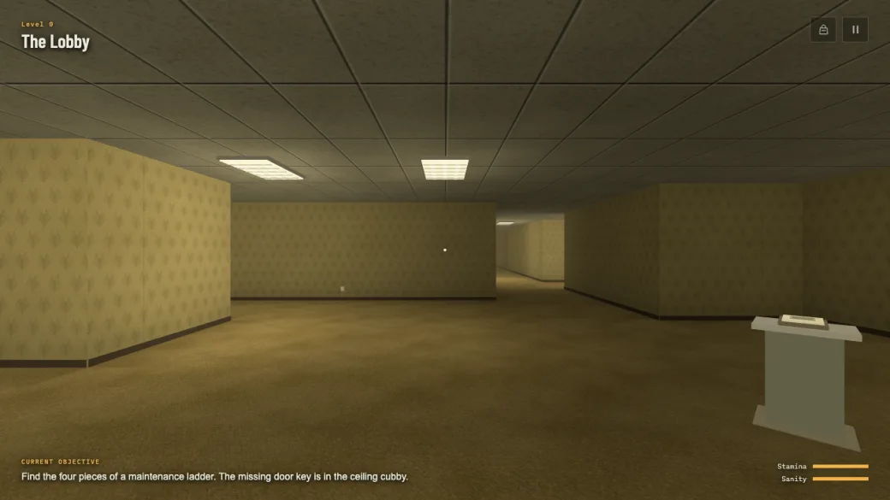
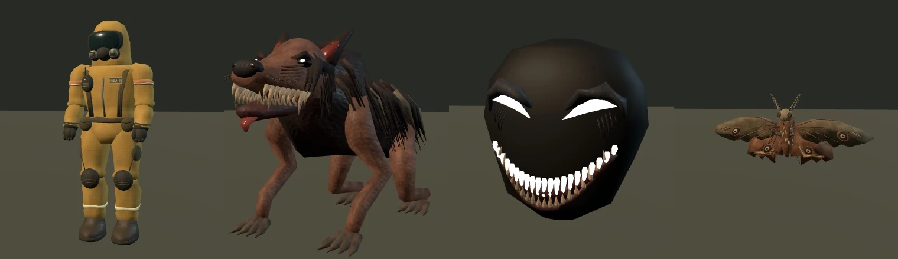

# Backrooms After Hours

**[Play in your desktop browser](https://tenthousandonehundred.github.io/backrooms-after-hours/)**

A first-person solo and co-op browser game inspired by *Escape the Backrooms*. Find four broken ladder pieces in the yellow lobby, make your way through the Habitable Zone, and follow the campaign into the Poolrooms, Terror Hotel, Plastic Mariana, and the arcade. The Bunker connects the ending routes. Four discoveries unlock the fifth ending on the same save.

The east telephone exchange links Records, Dispatch, and the old switchboard to the original Level 0 corridors. Two ladder pieces went missing there. Ringing phones draw the Bacteria, and staying in its sight can turn a stalk into a charge. From inside a locker you can hear its claws dragging past. Footsteps in the next aisle can give it away before you see it. Sprinting makes noise, hiding breaks pursuit, and getting caught kills you and sends you back to your checkpoint.

The game uses original, condensed layouts that recreate the campaign progression. Each area loads as you enter it. Checkpoints, puzzle progress, inventory, discovered endings, and settings are saved in the browser you use to play.



In the Lobby, the Bacteria shares its hunting ground with two other creatures. The **Veil** sings when you look into its floating masks. Turn away or break sight to escape its hold. The ceiling-dwelling **Bellwether** knocks twice before listening. Stand still or crouch-walk until it tolls. The toll draws the roaming hunter toward the bell, giving you a chance to slip past. The masks also appear in the guest wing, and a Bellwether hangs in the archive.

## Controls

| Action | Input |
| --- | --- |
| Move and look | WASD and mouse |
| Look without mouse capture | Drag the view or use the left and right arrow keys |
| Sprint / crouch / jump | Shift / C or Ctrl / Space |
| Interact, pick up, or hide | E |
| Flashlight or lidar in Lights Out | F |
| Toggle mic for monsters and nearby teammates | M |
| Hold to transmit on the co-op walkie-talkie | V |
| Almond water / energy bar | 1 / 2 |
| Inventory / pause | Tab / Esc |

The field manual on the title screen lists controls and ending discoveries. Continue expedition returns to the latest checkpoint. Starting a new run replaces that browser's campaign record.

## Multiplayer

Choose **Multiplayer → Create room** and share the six-character code. Friends choose **Multiplayer**, enter that code, and select **Join room**. The host selects **Start expedition**. Eight explorers can play, including the host. A full room turns additional players away until someone leaves.

The whole campaign supports co-op. Split up to collect supplies, operate equipment, solve keypads and carry objects. Any explorer who opens an eligible exit takes the team to the next area. Everyone sees the ending together, and the host chooses when to continue. All five endings count toward the room’s shared record.

In the room lobby, the host can switch **Game mode** from **Campaign co-op** to **Monster Hunt** and choose who plays the Bacteria. Hunt is a separate Level 0 round for 2–8 players. Explorers win by unlocking the service exit. The Bacteria wins by taking their last lives. Press **E** to grab an explorer in front of you. The monster sees only a few metres, but a small arrow points toward the strongest audible explorer. Sprinting carries farther than walking, and crouch-walking is quiet. Press **M** for proximity chat. The monster can hear nearby speech through walls and can listen with its own microphone off. Only explorers have radios. After the round the host can change roles or return to the campaign in the same room.

Choose Easy (5 lives), Medium (3 lives), or Hard (1 life). Each explorer has their own lives, which refill at the next level. In single player, a spare life lets you retry your checkpoint. When you run out, you restart at the level entrance. In co-op, the host chooses the difficulty. With lives left, you respawn at the entrance. Once you run out, you spectate until a teammate reaches the next level. If everyone runs out, the host can retry the current level with completed objectives intact. The host’s browser saves the co-op campaign separately from single player. Create a room on the same browser and choose **Continue saved campaign** to pick up at your last area. Friends can join a campaign in progress using its current room code.



The host's browser runs the room. Keep that tab active while playing. Closing it ends the room. Each device renders its own view. Explorer poses, microphone loudness and game state travel over the WebRTC data channels. [PeerJS Cloud](https://peerjs.com/server/getting-started) provides room discovery and connection signaling. Some networks restrict peer connections. No installation or account is required. Standard graphics caps multiplayer rendering at 30 FPS to reduce battery use. [Networking library licenses](public/licenses/Multiplayer.txt).

## Proximity chat, walkie-talkies and monster hearing

In multiplayer, press **M** during play and allow microphone access to talk. You can listen with your own mic off. Friends sound loudest within two metres. Ordinary speech fades out around 13 metres. The loudest shouts carry up to 96 metres in an open hall and can draw distant monsters. Walls and lockers muffle voices. Their voices pan left or right as you turn. Voice travels directly between nearby players over WebRTC.

**Hold V** to use your walkie-talkie, and release it to stop. It works with proximity chat switched off. Every living teammate in play can hear the broadcast anywhere on the level. The HUD shows who is transmitting. Radio audio passes through the host. Nearby monsters can hear your key-up chirp and speech at your position and at each teammate’s receiving radio.

Monsters hear the loudness of the same microphone in both multiplayer and single player. The HUD meter shows your volume. **Heard you** means a nearby creature picked it up. Loud sounds reach farther, walls and lockers muffle them, and a roaming hunter can follow your last audible position even when you stand still. Stay quiet after the Bellwether’s warning knocks.

The browser measures loudness locally. Each room starts with your mic off. Pausing, dying, or leaving play cuts voice chat. Master volume controls what you hear. Use headphones to keep sound from your speakers out of the mic.

## Make and play mods

Open **Mods** on the title screen to import a JSON expedition or play **Dead Letter Office**, a two-level sample. Mods have independent checkpoints. The [modding guide](https://tenthousandonehundred.github.io/backrooms-after-hours/modding.html) includes a working first room, the tile alphabet, supported monsters, and the full marker reference. Edit the [sample file](public/mods/dead-letter.json) to build and share your own expedition.

## Run locally

Use Node.js 24 and npm.

```sh
npm ci
npm run dev
```

Open the localhost URL printed by Vite. To check the campaign and play the production build:

```sh
npm test
npm run build
npm run preview
```

The GitHub Pages workflow runs the campaign tests and TypeScript build, then deploys the static output from `main`.

## Credits

Created as an unofficial fan game. *Escape the Backrooms* is the gameplay reference by Fancy Games and Blackbird Interactive, published by Secret Mode. The story route was cross-checked against a [recorded solo playthrough](https://www.youtube.com/watch?v=JSLfVceuQQU), a [campaign guide](https://steamcommunity.com/sharedfiles/filedetails/?id=2917649860), and the [publisher's Level 421 update](https://wearesecretmode.com/escape-the-backrooms-patch-notes).

The Bacteria’s split enamel hood folds around two rows of inward-facing teeth. Its jaw, throat and shoulder plates are bound to the Blender skeleton, with baked textures for the pitted enamel and hide. It uses skeletal animations for listening, stalking, chasing, winding up, striking, and recovering. It leans into sharp corners and turns its head and opens its jaw when it hears your microphone. Both reactions layer over its stride. Its fatal close-up comes from the live 3D model. The editable [Blender source](art/Bacteria.blend) and [browser model](public/models/bacteria.glb) are included. The Veil’s masks and trailing shroud drift, fixate and recoil when you break eye contact. The Bellwether’s clapper and ten petals have separate roost, knock, listening, toll and settling actions. Both rigs and their editable keyframes are in the [residents’ Blender file](art/Residents.blend). The remaining creatures use geometry, painted materials and keyed actions from the [bestiary](art/Bestiary.blend) and [level creatures](art/LevelCreatures.blend) Blender files. Ground creatures blend idle, stalking and chase actions. Their strides advance with distance traveled, while the Deathmoth keeps beating its wings in a hover. At close range, the roaming monsters telegraph a bite, swipe or grab. The last part of each Blender action follows the capture timer and releases if you get away. The Bone Thief’s reach tracks its own attack timer. Their in-game bodies also appear in their capture close-ups. To re-export either library, use glTF Binary with NLA Tracks, Slide to Zero, custom properties and the named vertex color layer `Patina`. The rooms combine procedural geometry with [scanned materials from Poly Haven](public/licenses/Environment-surfaces.txt). The sound is procedural. OpenAI ImageGen was used for the title artwork and the Hound and Smiler portraits. Three.js is distributed under the [MIT license](public/licenses/Three.txt). Barlow Condensed and IBM Plex Mono are bundled under the [Barlow](public/licenses/Barlow-Condensed.txt) and [IBM Plex](public/licenses/IBM-Plex-Mono.txt) SIL Open Font Licenses.

## Playability checks

The unit tests verify map reachability, required items, physical puzzle inputs, and ending gates. There is also a browser route test that drives movement, mouse look, interaction keys, keypads, retries, and ending choices through a fresh campaign. It accelerates the simulation clock and samples a rendered frame in each scene.

To run it, start the development server, open it in a fresh browser profile, then run the following in that page's developer console. The test starts a new run in that profile.

```js
await (await import('/tests/player-route.mjs')).runRoute()
```

For a shorter check, pass `{ lobbyOnly: true }` to test hiding from the Bacteria, its attack, and retrying with the ladder piece still in your inventory.
